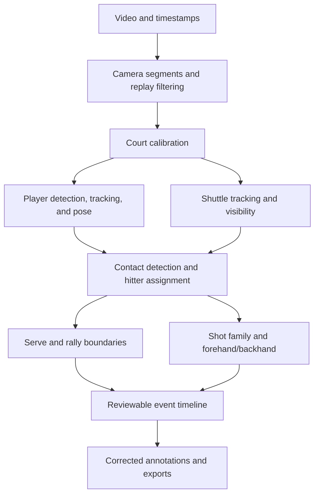

# Badminton match analyzer: project plan

Prepared October 17, 2026; current status verified October 24, 2026 (UTC).

Development follows the [autonomous collaboration protocol](docs/COLLABORATION.md): GitHub Issues hold bounded tasks, a serialized dispatcher grants ownership, local Mac/Windows agents implement with optional code review, and controller-enforced integration verifies merged main. Both host pilots and their deliveries passed; [active rollout PR #92](https://github.com/Ken0u/badminton-match-analyzer/pull/92) and the [Windows completion record](https://github.com/Ken0u/badminton-match-analyzer/issues/80#issuecomment-6268644934) supersede the [DevOps report's](docs/AUTONOMOUS_DEVOPS_REPORT.md) bootstrap snapshot. GitHub Free controller enforcement requires no Pro or branch protections; all writers must honor it because GitHub does not block bypasses. The repository and candidate builds/images are now public; the Project remains private. Running apps are not automatically upgraded.

Scope update: half smash has been removed. The six target families are clear, lift, net, drop, smash, and drive, each with forehand/backhand labeling.

## Current evidence and remaining work

Snapshot updated October 24, 2026 (UTC), after verified delivery of #220, #238, #242 and #243. The upload/YouTube, review/export and resumable processing application is delivered. Correct automatic annotations throughout unseen singles and doubles matches remain unproven. The following are separate development measurements, not interchangeable accuracy benchmarks.

| Area | Verified progress | Remaining limitation |
| --- | --- | --- |
| Product and reliability | [Full-source processing](docs/FULL_MATCH_PROCESSING_REPORT.md), [React review/export delivery](docs/FRONTEND_REWRITE.md), [exact-frame recovery](docs/EXACT_FRAME_RECOVERY_REPORT.md) and [fixture ownership/shutdown repairs](docs/FRONTEND_FIXTURE_PROCESS_REPORT.md) are integrated. [CI bootstrap delivery](https://github.com/Ken0u/badminton-match-analyzer/issues/200#issuecomment-6356150840) preserves required checks. The [completed-import refresh repair](https://github.com/Ken0u/badminton-match-analyzer/issues/215) is delivered at `3fb8d80a88e016f673a688795b01c97ca1403fe3`: a failed or superseded library read no longer acknowledges an import refresh before the current read commits. | The [#243 cache repair](https://github.com/Ken0u/badminton-match-analyzer/issues/243#issuecomment-6388278334) also rejects observable same-size source/timestamp/proxy changes with restored modification times. Complete processing and green software checks do not establish correct contacts, serves, endings, identities or strokes. Cache reuse depends on reliable filesystem change metadata; hidden changes remain outside that guarantee. Original failed CI fixture lifetimes and causes remain unknown; prospective shutdown evidence does not establish their historical cause. |
| Familiar-source shuttle measurements | [Visibility audit](docs/SHUTTLE_VISIBILITY_REPORT.md): 14/25 visible cases localized, 7 confirmed negatives with 3 false observations, and 28 unknowns across 60 centers. [768x432 comparison](docs/SHUTTLE_RESOLUTION_REPORT.md) also localizes 14/25 and is rejected. The [fixed 0.25 threshold experiment](docs/SHUTTLE_THRESHOLD_REPORT.md) improves selected localization from 14/25 to 17/25 but increases displaced outputs from 1/25 to 2/25 and false observations from 3/7 to 4/7; it is rejected. | The application stays at 512x288 and threshold 0.5. All 60 cases and 28 unknowns remain. Agent source labels are not expert gold truth. Eleven visible default cases lack an agreeing observed component; ranking existing components alone cannot recover them. [Heatmap response](docs/SHUTTLE_HEATMAP_REPORT.md) is separate from selected localization. |
| Published coordinate corpus | [Preparation](docs/SHUTTLE_SUPERVISION_REPORT.md) retains 201 clips, 91,214 rows and 91,579 native frames. [Unchanged-tracker diagnostic](docs/SHUTTLE_CORPUS_DIAGNOSTIC_REPORT.md) reaches localization agreement F1 0.975836 on 78,979 eligible published rows. | All 12,235 rows from 25 incomplete CSVs remain quarantined; 365 unlabelled tail frames are retained. Familiar upstream-reference agreement is not independent accuracy. Mirror provenance, dataset/media rights, original-match overlap and exact checkpoint membership remain unresolved; training-ready rows remain zero. |
| Source eligibility and label revisions | The [public evidence audit](docs/SHUTTLE_ELIGIBILITY_REPORT.md) retains all 29 corpus groups and both broadcast slots. [Actual #220 accounting](docs/SHUTTLE_LABEL_REVISION_REPORT.md) binds the preserved original Test labels to 29 pinned upstream corrected objects: 29 literal cases and 12,656 records per side, equal raw ordinal sets, and 29 unequal byte strings. | All 29 native comparisons remain unscored with null bases and inherited quarantine. Byte inequality does not establish numeric changes, corrected accuracy or expert truth. Three archive/upstream `2_` filenames still disagree with the creator inventory's `1_` names; no aliases were introduced. Independent native source/clock correspondence, media rights, original-match overlap and exact checkpoint membership remain unresolved. All four eligibility flags stay false; training-ready rows remain zero. |
| Additional broadcast sources | [Native preparation](docs/SHUTTLE_SOURCE_PACKET_REPORT.md) covers 248,100 frames. [Completed source assessment](docs/SHUTTLE_SOURCE_ASSESSMENT_REPORT.md) retains all 128 centers: 37 localizable, 1 unlocalizable, 5 supported negatives and 85 unknowns. [Frozen diagnostic](docs/SHUTTLE_BROADCAST_BASELINE_REPORT.md) completes 128 windows / 8,192 rows: 16/37 selected locations agree, 6 are displaced and 15 missing; outputs are available for every center. | Only 17/37 have any agreeing observed component. Center-only scenes do not certify whole-window live context. The five negatives have no false observations, but unknowns remain unscored. These are agent-labeled development sources; training, independent-test, deployment and redistribution eligibility remain false. |
| Complete-rally references | The [completed assessment](docs/COMPLETE_RALLY_REFERENCE_REPORT.md) retains two sources and all 1,532 native frames: 512 original successes and 256/256 validated targeted references, including 21/21 recovery sessions. Required/inspected target frames are 991/991 singles and 541/541 doubles. Unchanged scientific acceptance yields **0/2 complete references** and **0/2 fully supported observed-contact label slots**. | Singles retains overlapping contact intervals; both slots retain unresolved targeted source evidence and unsupported opening/terminal boundaries. Full frame coverage does not resolve these unknowns. All four eligibility flags remain false. #62 stays open; #66/#67/#71 remain dependent on actual references. No further image pass or weaker gate follows from this completed recovery. |
| Rally evidence diagnostics | The [#238 metadata census](docs/RALLY_REFERENCE_DIAGNOSTICS_REPORT.md) preserves all 1,532 frames, 1,014 historical execution identities and 256 validated targeted references. It distinguishes repeated event mentions, conflicting variants and overlapping contact intervals without new image review. | Singles adjudication has no terminal event; doubles has no serve and only a stopped-play ending. Contact actor support remains unresolved. Deduplicating repeated signatures cannot resolve the overlapping distinct-contact pair or establish a complete rally. The unchanged result remains 0/2. |
| Sparse temporal context | [Six specifically authorized #242 readings](docs/RALLY_TEMPORAL_CONTEXT_REPORT.md) reuse the five prepared galleries, using exactly 34,040,436 new image bytes. Known A/B scene equality is 32/34 singles and 18/19 doubles sampled frames; all six new execution identities passed the global audit before comparison. | Same-model agreement is not accuracy or expert truth. Unknown scenes and unresolved actor transitions remain. All 1,479 unsampled native frames remain unreviewed in this sparse pilot; the earlier exhaustive native assessment is separate. These readings supply no exact contacts, precise boundaries, continuous identity or family/side truth. Complete references remain 0/2 and all four eligibility flags false. |
| Mac player evidence | [CPU runtime diagnostic](docs/MAC_PLAYER_RUNTIME_REPORT.md) completes 50 native frames per installed model. [Sparse source audit](docs/MAC_PLAYER_AUDIT_REPORT.md) matches 20 of 22 source people against 23 predictions on 11 frames; 2 people and 3 predictions are unmatched. All 14 eligible sampled transitions retain their ID; 10 ineligible transitions remain explicit. | Counts and automated source assessments do not establish human-label accuracy, pose correctness or persistent identity. Sparse sampling cannot exclude switches between frames, across cuts, on doubles or on unseen matches. No model is promoted. |

The [assessment delivery record](https://github.com/Ken0u/badminton-match-analyzer/issues/172#issuecomment-6329916985), [broadcast completion](https://github.com/Ken0u/badminton-match-analyzer/issues/179#issuecomment-6330961225) and [Mac audit completion](https://github.com/Ken0u/badminton-match-analyzer/issues/183#issuecomment-6328133046) establish completed integration/delivery where individual report revisions still describe pending checks. They preserve earlier failures and original experiment source revisions. Raw media, labels, caches and weights remain local and ignored; a clone supplies reproducible code and aggregate evidence.

The [#228 completion record](https://github.com/Ken0u/badminton-match-analyzer/issues/228#issuecomment-6383914664) verifies controller merge `4f0a93b0a952bd0d256cb602b915d5a299cc63b0`, all 12 exact PR/main jobs and complete public delivery. Independent verification checks 86 runtime files, package/source/frontend/lock parity and both anonymous image manifests/configs. Image descriptor HEAD availability does not prove layer bytes, runtime behavior or image/source parity. Successful software delivery remains separate from the zero-reference scientific result. Earlier incomplete pilots, elapsed clocks, failed outputs and rejected experiments remain preserved.

Later completion records verify [#220 label accounting](https://github.com/Ken0u/badminton-match-analyzer/issues/220#issuecomment-6385528052), [#238 diagnostics](https://github.com/Ken0u/badminton-match-analyzer/issues/238#issuecomment-6386909933), [#243 cache hardening](https://github.com/Ken0u/badminton-match-analyzer/issues/243#issuecomment-6388278334) and [#242 temporal context](https://github.com/Ken0u/badminton-match-analyzer/issues/242#issuecomment-6389782093). Latest source `9668be831014820e0a4e620f3c277032a04a39c5` passed all 12 exact PR/main verification jobs on first attempts. Independent delivery checks verify 89 runtime files, package/source/frontend/lock parity and both anonymous image manifests/configs/descriptors. Descriptor HEAD availability does not verify layer bytes, runtime behavior or image/source parity. Local #242 checks passed 459 focused / 2,941 full tests with four optional skips; these remain software evidence. No running application, annotation truth or model is automatically upgraded.

The cleanup repairs separate shutdown observation from permission to signal, retaining full identity checks before each signal and requiring independently observed absence. [#192 delivery](https://github.com/Ken0u/badminton-match-analyzer/issues/192#issuecomment-6353942809) required one owner-authorized unchanged-source retry after slow package downloads timed out two main jobs before their tests/fixtures started; [incident #195](https://github.com/Ken0u/badminton-match-analyzer/issues/195#issuecomment-6353942996) is closed and the queue resumed through the documented request. A later documentation CI exposed live status with empty metadata. The delivered [#197 follow-up](docs/FRONTEND_FIXTURE_PROCESS_REPORT.md#incomplete-live-status-observations-197) permits bounded observation of that same lifetime and prevents an empty cwd resolving into signal authority. Its frozen comparison improves from 12/18 to 18/18 expected outcomes; all 12 PR/main jobs and public delivery pass on their first attempts. Fresh main browser receipts verify 18/8/13 groups and three complete cleanups, without naturally repeating the live-status shape. No checks, deadlines, escalation limits or policy changed. The standalone POSIX process regression is not invoked by current CI; actual Linux lifecycle evidence and the injected regression remain distinct.

The [Ubuntu CI bootstrap repair](docs/CI_BOOTSTRAP_REPORT.md) now reuses working native libraries, installs missing original packages and routes recognized Ubuntu archives through the official HTTPS archive while preserving signatures, suites and architectures. All 12 PR/main checks and public delivery pass on first attempts. The new codec preparation takes 22–36 seconds across those runs; this does not establish the earlier network cause or guarantee future speed. Both failed documentation-PR attempts remain preserved. Separately, the [Project reader repair #202](https://github.com/Ken0u/badminton-match-analyzer/issues/202) is delivered at `38af56364dace02b0762a325bd71dee376b27c78`. It reads coordination content above the Contents API inline limit through verified Git blobs. Its completion audit matches all 67 then-managed statuses and preserves all 33 historical cards and Project privacy. The original projection failures remain recorded; the private dashboard is never an ownership grant.

Next implementation priorities, each requiring its own bounded controller grant:

The [#250 joined-evidence protocol](docs/RALLY_EVIDENCE_JOIN_REPORT.md) now
assembles and audits all 1,532 native frames with 53 sparse samples, retaining
6,120 native frame and 159 coarse frame occurrences and prospective source-bound
review questions. It preserves every conflict and the historical 0/2 result.
A separately authorized contiguous source review is still required; this task
sends zero new images and supplies no new resolved annotations. Consult its
report and owning issue for verification and integration evidence.

1. Freeze a separate source-review protocol joining temporal scene context to contiguous native contact evidence, locally supported actors and opening/terminal context. Distinguish repeated mentions from distinct physical contacts and retain inclusive uncertainty intervals, unknowns and the completed 0/2 result. Sparse scene agreement and exhaustive image coverage cannot certify a complete rally. The six-session #242 allowance is completed; it authorizes no further image dispatch, replacement assessor or reuse of an expired scientific clock.
   The [#262 prospective review planner](docs/RALLY_REVIEW_PLAN_REPORT.md) prepares
   and independently audits exact native-frame/temporal-gallery batches and
   repeated-byte costs before any new assessment authorization. The original
   1,532-frame/53-sample schedule is planned: 1,209
   proposed sessions / 10,576,441,872 proposed image bytes across
   three lanes. Actual new sessions/image bytes are zero; the historical 0/2
   scientific result and four false eligibility flags remain unchanged.
2. Establish independent original-media/clock correspondence and applicable source usage/provenance before native label comparison or training. #220 completed byte/ordinal publication accounting; its null bases deliberately withhold native comparison. Preserve the creator filename discrepancies, quarantines, unavailable cases, false eligibility flags and zero training-ready rows.
3. Improve shuttle component recall and distractor separation using eligible source-aligned development supervision after resolving rights, original-match overlap and checkpoint membership. Freeze detector experiments before predictions; retain both rejected resolution/threshold results. Evaluate automatic scene context separately.
4. Investigate player motion/occlusion misses, extra detections and within-view continuity with independently assessed evidence; expand to doubles and cross-camera identity without interpreting local track IDs as player names.
5. Once defensible references exist, evaluate complete contacts, hitter identities, serves/endings, all six family/side combinations and correction time on separately frozen unseen original matches. Source preparation, conditional classifier scores and processing coverage cannot satisfy that release gate.

No historical consumed holdout is reopened or retuned here. Test-informed changes require another original-source-separated holdout. Rejected RGB, recognition, appearance and resolution experiments remain recorded below; no additional model promotion follows from this status update.

## Earlier increments and their dated evidence

The following records retain their original measurements and development priorities. Later completion records and the current snapshot above supersede historical pending work; historical test counts are not the current suite size.

The [frozen holdout recovery](docs/HOLDOUT_RECOVERY_REPORT.md) completes all 75 rallies / 21,610 native frames and the original frozen R2/R3 comparison, reusing 67 completed input chains and ordinal 67's player run. All 860 source rows, both 677-row eligible denominators and unavailable inputs remain preserved. Predeclared R3 reaches requested-family macro F1 0.465 and strict conditional family/side accuracy 0.421 without confidence abstention; its original validation thresholds reduce the latter to 0.143. These failures do not support model promotion. Next improve source-aligned supervision, missing inputs, weak families and complete-event/identity evaluation on development sources; freeze another complete-source holdout for test-informed changes. Full automatic annotation correctness remains unproven.

The [direct-video learner](docs/VISUAL_EVENT_LEARNING_REPORT.md) completes source-clock RGB feature preparation on all 800 labelled clips, the fixed 100-epoch training schedule and frozen 200-clip test. Contact F1 is 0.159; complete time/family/side/court-end tuple F1 is 0.028 against published weak references. The model is rejected for app promotion. Backhand smash has no test support; doubles, identities, serve/end accuracy and correct full-match annotations remain open. Continue development with source-aligned and independently reviewed supervision while preserving this test result.

The [follow-up supervision audit](docs/FOLLOWUP_SUPERVISION_REPORT.md) verifies broader singles/doubles label sources and documents conflicts, overlaps and usage terms. It also recovers the exact original ShuttleSet holdout through normal public access: all 75 rallies / 21,610 native frames / 860 rows are clock-verified. Its [frozen conditional comparison](docs/HOLDOUT_RECOVERY_REPORT.md) is now complete, retaining unsupported cases and guarding close-ups and transition wipes. Preserve this consumed holdout and use another complete-source holdout for test-informed changes.

The [AI CUP contact-supervision increment](docs/AICUP_CONTACT_SUPERVISION_REPORT.md)
adds a pinned archive importer for 7,845 published contact/family/side records
from 800 training rallies, with all 169 unlabelled clips preserved. Source hashes,
schema mappings and structural checks pass; all 969 clips decode with valid
source clocks. Exact contact ordinals and original-match grouping still require
adjudication. The published
visual detector cannot yet be reproduced from its incomplete preprocessing;
no replacement model is installed. The capture-separated RGB experiment above
has now run; finish exact source alignment and original-match deduplication for
further development. Full-match annotation correctness remains open.

The [player tracking study](docs/PLAYER_TRACKING_RECOVERY_REPORT.md) rejects two standalone association changes after full-source checks expose new breaks and a doubles partner swap. The current candidate retains baseline observations and uses motion corroboration only for unambiguous short fragment joins, with source-context invalidation. The [fixed appearance study](docs/PLAYER_APPEARANCE_REPORT.md) also rejects appearance-only identity links. Continue source-reviewed continuity and independent full-match validation; these development checks do not establish complete identities.

The [overlap actor increment](docs/ACTOR_CONTINUITY_REPORT.md) now links repeated source-frame player observations across processing windows and displays provisional actor hints. It preserves reviewed identities, excludes unsupported frame gaps and never bridges camera cuts. Actual CPU linking on all cached player windows finds 10 singles and 25 doubles links; these are unadjudicated hypotheses, not roster counts or identity accuracy. Next: source-reviewed within-run switches and cross-view identity recovery, alongside unresolved scene, contact/boundary and recognition accuracy.

The [FineBadminton increment](docs/FINEBADMINTON_REPORT.md) verifies and normalizes 20,757 public singles stroke records, joins 414 separate published contact frames, and checks two actual source clocks. Native inputs cover all five published contact-labelled rallies from one source, with 80/83 usable conditional actor descriptors. A controlled training-only augmentation slightly improves joint agreement but lowers family macro F1 on the unchanged weak validation source, so the model is not installed. Next: broader balanced aligned supervision and the remaining contact/input failures, while preserving match-level splits, unavailable cases and the separate gated test.

The [resumable full-match increment](docs/FULL_MATCH_PROCESSING_REPORT.md) now connects all-source camera/perception/proposal stages, interruption recovery and windowed review. Generated 130-second API/browser checks and actual CUDA processing of all 24,171 supplied source frames pass. Independent checks verify all 92 artifacts, byte-identical cache-only resume and native window review. This provides processing coverage while preserving unknown identities and unsupported labels. Full-match annotation correctness remains unproven.

The [automatic court baseline](docs/AUTOMATIC_COURT_REPORT.md) now supplies unreviewed geometry directly to player tracking and downstream context, with manual priority, cut expiry and stale-result guards. Actual singles/doubles/red-court integration checks preserve saved labels; 16 development images and synthetic tests do not establish unseen court accuracy. Next: broader camera/visibility evaluation, automatic identities and resumable whole-match processing alongside the unresolved contact and stroke models.

The [observed-flight representation study](docs/OBSERVED_STROKE_CONTEXT_REPORT.md) compares guarded 371/443-value raw-video inputs on all training/validation references. The narrower context improves validation family macro F1 to 0.590 but still fails requested classes and joint recognition; the wider context is rejected. Its all-75-rally singles comparison was frozen before predictions and is now [complete](docs/HOLDOUT_RECOVERY_REPORT.md). The source remains conditional on weak clock/hitter/court evidence and does not establish complete automatic events, identities or doubles accuracy. Continue source alignment and development-data improvements while preserving this held-out result and the original full-match objective.

The [wrist-reach correction](docs/WRIST_REACH_REPORT.md) removes a source-inspected floor-bounce contact while preserving missing-pose fallback and five cached comparison excerpts. The [first raw-video learning evaluation](docs/R2_LEARNING_REPORT.md) is now complete on all 203 source rallies with validation-only model selection. Held-out weak-contact F1 is 0.790, conditional family macro F1 is 0.498, and requested-family failures prevent default integration. Next: improve observed flight/hitter evidence and sparse/confused families on training/validation, establish another independent source holdout, and promote only a supported reproducible recipe. Neither model is installed in the app.

The October 18 [camera-context audit](docs/EARLY_CAMERA_CUT_REPORT.md) fixes an early-edit detector miss and complete temporal evidence ranges. It also exposes and corrects mixed-camera research inputs before any model optimization. Corrected extraction spans 203 source rallies with fixed match-level splits. Integrating a supported model, completing whole-match processing, and establishing unseen full-match correctness remain open.

End-state requirement: a polished, deployable application that accepts uploaded videos and YouTube match links and correctly annotates supported singles and doubles footage throughout each match. Keep expanding difficult camera/visibility cases toward that full objective; the existing review tools and small pilot are intermediate deliverables. Claims of complete correctness require verified end-to-end evidence on unseen full matches. Each implementation increment uses a feature branch, focused commits, a tested PR, and a merge into main. Run regression checks and investigate failures continuously.

The input/deployment increment adds bounded video uploads, single-video YouTube imports with source provenance, authentication for a network listener, configurable persistent storage, container targets, and CI checks. Full automatic analysis, playback proxies, camera/replay segmentation, complete-rally labels, and classifier training remain open requirements.

Implementation has begun: video ingestion, the annotation/review application, GPU player/pose tracking, TrackNetV3 shuttle tracking, and reviewable contact proposals are working. See [the initial baseline report](docs/BASELINE_REPORT.md) and [the bug review and latest results](docs/BUG_REVIEW.md) for completed work, measurements, and remaining milestones.

Reviewed tracker-to-player mappings, exhaustive clip review coverage, manual shuttle points, and source-aligned contact/localization evaluation now work through the UI, API, and CLI. A small visually reviewed development pilot covers partial singles and doubles rallies; [its report](docs/PILOT_REPORT.md) distinguishes measured failures from unvalidated accuracy. The gap-aware contact detector removes a false apex and recovers one hit as an uncertain interval, but still misses contacts.

The first recognition increment integrated a pinned pretrained BST-0 singles family head with explicit review, abstention, and preserved source predictions. [Its report](docs/SHOT_RECOGNITION_REPORT.md) describes the adaptation and local GPU/browser checks. It was an experimental inference baseline; subsequent data/side-head work is recorded below. Direct-video recognition evaluation, complete-rally labels, and doubles extension remain required. Keep improving contact recall alongside recognition; several output labels without verified family truth do not establish accuracy.

The data/evaluation increment imports a pinned snapshot of all 44 ShuttleSet matches into a separate source-verified index, with published match splits, known-error quarantine, raw side flags, and no assumed universal frame rate. It adds independent-label family/side/complete-event metrics through the API, CLI, and review screen. [The data report](docs/STROKE_DATA_REPORT.md) records 36,484 source rows and 21,709 label-eligible rows; direct-video alignment remains unverified. Expand independent local full-rally labels and contact recall alongside recognition.

The first learned stroke-side baseline now uses the authors' separate published MMPose feature archive, joined to the quality-filtered labels. It trains a small head on 10,149 clips, selects its epoch on 1,233 validation clips, and evaluates the frozen selected weights on 1,138 test clips. Closed-set side balanced accuracy is 0.942 with known hitter court end; strict balanced recall falls to 0.879 when its abstentions count as misses. The conditional family/court-end/side tuple result is only 0.718. [The side report](docs/STROKE_SIDE_REPORT.md) records those limits, sparse backhand drops/smashes, and the packaged experimental predictor. This does not complete stage 3. The immediate next step is source-video alignment and recognition evaluation on actual YOLO features, followed by missing-contact, rally-boundary, rare-stroke, and doubles work.

The direct-video increment has now run YOLO, TrackNet, contacts, and recognition on a 163-frame public-source excerpt. Both unadjudicated reference windows abstain; [the report](docs/DIRECT_VIDEO_REPORT.md) records the gap between published cached features and actual video inputs. Exact source-contact alignment is still open. An experimental, default-off audio/vision aid adds review intervals containing both missed singles pilot contacts; [its report](docs/AUDIO_CONTACT_REPORT.md) preserves the tighter timing and doubles limitations. Next: independently adjudicate and expand complete live rallies, measure visual/optional-audio contacts, compare recognition at adjudicated YOLO contacts, then train event/domain adaptations on development splits. Serve/rally-end detection, doubles recognition, automatic identity recovery, and full-video segmentation remain unfinished.

The camera-boundary increment scans full videos and separates new player/shuttle processing at detected edits. [The camera report](docs/CAMERA_BOUNDARY_REPORT.md) records both sample scans and a real CUDA probe across two cuts. Tracker ID reuse across views, mixed-camera TrackNet contexts/backgrounds, stale court filtering, and contacts ignoring player-run cuts are addressed. This begins full-video segmentation; live/replay classification, reviewed scene corrections, and an automatic full-match pipeline remain open. Next, establish independent camera/scene and complete-rally labels, add scene corrections/live-replay handling, and continue contact/serve/end and YOLO-domain recognition work.

Reviewed camera corrections and scene ranges are now implemented. Saved corrections drive tracking resets and calibration expiry; changed boundaries invalidate cached inputs. Replay, non-play, and explicitly unknown scene ranges suppress event suggestions without changing raw predictions or reviewed events. A source-verified first visual pass labels 125 intro/title-card frames per sample as non-play, with human adjudication pending. [The scene-review report](docs/SCENE_REVIEW_REPORT.md) records this narrow evidence and the actual CUDA override probe. Automatic scene classification and complete live-rally labels remain open. Next, expand independent full-rally and scene annotations, establish reliable direct-video contact/serve/end evaluation, then improve event and recognition models on development splits before extending to doubles and unseen full matches.

The first full-view boundary audit now records service and terminal uncertainty for the opening singles and doubles exchanges. Rally endings have separate inclusive uncertainty fields in the editor, schema, history, and exports; unresolved source frames are preserved instead of inventing a precise ending. [The boundary report](docs/RALLY_BOUNDARY_REPORT.md) documents four first-pass boundary intervals and their broad limits. Intermediate contacts are not exhaustive, doubles server identity remains unknown, and human scene/timing adjudication is pending. Next, finish independently reviewed full-rally contact/scene labels and use those frozen labels for actual serve/end and YOLO-domain recognition evaluation before training adaptations. This is still evidence preparation, not an automatic rally detector.

Actual perception now covers both complete first court views (384 singles and 588 doubles source frames), with frozen boundary labels kept separate. It exposed overlapping-player and shuttle-visibility gaps, plus a native decoder-shutdown deadlock during a stronger-pose comparison. [The decoder report](docs/DECODER_SHUTDOWN_REPORT.md) records the source evidence and lifecycle fix. The larger checkpoint resolves some inspected occlusions; the following increment makes it selectable and the standard default, without claiming validated accuracy. Continue improving observed input quality and rally proposals, with independent complete-rally labels and explicit abstention on missing evidence; no automatic full-match correctness has been established.

The rally-proposal increment adds experimental serve/end intervals through the API, CLI and explicit editor review, plus pinned Standard/Lightweight player-model choices. [Its report](docs/RALLY_PROPOSAL_REPORT.md) records one singles ending and one doubles serve on the complete development views, with the other boundaries missed and server identity unresolved. Source timestamp/court/scene guards and draft staleness preserve raw evidence and saved labels. Next: independently adjudicated complete live rallies and shuttle visibility, improve missed boundaries and contacts against frozen labels, then expand unseen-match/doubles recognition and resumable full-video processing. These proposals do not complete the full-match objective.

The doubles supervision increment now verifies and normalizes 1,907 published rows across three original matches, with explicit unknown timing/side conventions, quality exclusions and match-level splits. It fixes single-stroke serve-fault exclusions in the existing singles normalizer while preserving old data/model provenance. [The doubles audit](docs/S2_DOUBLES_REPORT.md) includes a newly accessible official public-source rally: actual inference emits only one contact proposal against 13 published references and misses its outside-sideline ending. These are development failures, not verified accuracy measurements. Next, use independently reviewed source timing and visibility to improve contact/ending evidence, then evaluate recognition and train doubles adaptations; no full-match correctness is established.

The contact-timing increment profiles between-frame transitions with a complexity penalty and moving-wrist evidence, and gathers bounded observed samples across nearby short gaps without filling positions. Full evidence context now controls scene exclusions through editor, recognition and evaluation. [Its report](docs/SUBFRAME_CONTACT_REPORT.md) records six proposals instead of one on the public development rally, with source inspection following predictions, not an independent accuracy test. Several contacts and outside-sideline endings remain missed, with ambiguous forecourt hitters unknown. Next: independently adjudicated contact/visibility evidence, better shuttle localization and terminal-action handling, then actual doubles/domain recognition training and whole-match processing.

Build an offline video analyzer that produces a reviewable timeline of rallies and shots. Develop a complete singles workflow first, then extend it to doubles while keeping four-player support in the data model from the beginning. Reuse pretrained perception models and train the badminton event and shot classifiers on curated annotations.

The first useful release should combine automatic suggestions with quick correction. Full automation across unfamiliar cameras and venues is a later quality milestone.

## Starting point and assumptions

At planning time, the repository contained two videos and no application code:

| File | Video duration | Resolution | Frame rate | Frames |
| --- | --- | --- | --- | --- |
| `singles.mp4` | 8:00.92 | 1280 × 720 | 25 fps | 12,023 |
| `doubles.mp4` | 8:05.92 | 1280 × 720 | 25 fps | 12,148 |

Both contain audio. Initial visual inspection confirmed that these are edited highlights with replays, close-ups, and alternative camera angles. The first tracking experiments therefore use short inspected full-court windows. Neither file should be assumed to contain an entire match or only complete rallies.

The available GPU is an NVIDIA RTX 3050 Ti Laptop GPU with 4 GB VRAM. Start with small models, one GPU stage at a time, small batches, and cached features. Benchmark before promising a processing speed. Larger training runs may need a separate GPU.

Working assumptions: local video files, offline processing, one target court, and a stable full-court camera during most rallies. Broadcast cuts and replays are expected input conditions to detect. Initial player identification means persistent IDs such as A/B/C/D, with optional user-entered names and handedness.

## Product behavior

1. Import a video and select singles or doubles.
2. Confirm the court corners and player/team assignments; allow handedness to remain unknown.
3. Process the video with progress reporting and resumable stages.
4. Review video synchronized with player boxes, shuttle trajectory, rally boundaries, and shot labels.
5. Jump between events, change labels, adjust timestamps, repair identities, and insert or delete missed or false events.
6. Export annotated video, rally clips, and machine-readable JSON/CSV. Show per-player shot counts and rally lengths derived from the reviewed events.

Every shot record contains its timestamp, rally, hitter, team, shot family, forehand/backhand label, confidence, and review status. Low-confidence results must be visible and editable.

## Label definitions

Store shot family and stroke side separately. This supports all 12 requested combinations without requiring equally large datasets for each combination.

| Field | Values or interpretation |
| --- | --- |
| Event | `serve`, `shot`, `rally_end` |
| Shot family | `clear`, `lift`, `net`, `drop`, `smash`, `drive`, `other`, `unknown` |
| Stroke side | `forehand`, `backhand`, `unknown` |
| Identity | Persistent player ID and team ID; unknown is allowed |
| Evidence | Contact frame/time, optional uncertainty interval, visibility and confidence |
| Review | Predicted, reviewed, or corrected; preserve the original prediction |

A serve is a separate event with a stroke-side label and no required shot-family value. Its contact time starts the rally; link that event from the rally record instead of counting a second opening shot. Service subtypes can be added later.

Draft annotation rules, to be finalized with examples before bulk labeling:

| Family | Main distinguishing evidence |
| --- | --- |
| Clear | Usually overhead contact, sending the shuttle high/deep toward the rear court |
| Lift | Low or underhand contact, sending the shuttle upward toward the rear court |
| Net | Forecourt touch intended to pass close over the net and remain short |
| Drop | Usually overhead contact from farther back, sending the shuttle short with reduced pace |
| Smash | Forceful attacking stroke with a downward outgoing trajectory |
| Drive | Fast, comparatively flat exchange, usually through the midcourt |

These are project annotation conventions, not complete rules for every variation. Include examples of sliced shots, defensive blocks, pushes, net kills, and mishits. Clearly observed strokes outside the six families become `other`; insufficient evidence becomes `unknown`. Do not force a block or net kill into a requested class simply to produce a label.

Forehand/backhand describes the stroke mechanics, not which side of the screen the shuttle occupies. Around-the-head forehands remain forehands. Account for left-handed players and body rotation.


Rally end means the observable termination of play, such as ground contact or a terminal fault, rather than the last racket contact. If the terminal moment is hidden, annotate an uncertainty interval. A missing shuttle detection alone is not proof that the rally ended. Mark rallies cut off at the beginning or end of a video as partial.

## Processing architecture



**1. Video ingestion and camera segments.** Use FFmpeg/PyAV or OpenCV to decode video while retaining source presentation timestamps. Generate a playback proxy with an explicit source-time mapping. Detect cuts, close-ups, non-play, and replay segments so the same rally is not counted twice. Preserve segment labels and allow corrections. Avoid inventing missing contact frames by increasing frame rate: these samples provide one frame every 40 ms.

**2. Court calibration.** Begin with manual corner selection for each stable camera view, then add automatic line/keypoint detection. Use court geometry to select the target court, distinguish sides, and normalize player positions. Allow a margin around the court so lunging players are retained. Recalibrate after camera movement. A court homography maps ground-plane points; it does not recover the position or speed of an airborne shuttle in 3D.

**3. Players and pose.** Evaluate a small pretrained YOLO person/pose model with ByteTrack or BoT-SORT as a baseline. The official implementation supports tracking and pose estimation. Use court context to exclude spectators and officials. [Tracking documentation](https://docs.ultralytics.com/modes/track), [pose documentation](https://docs.ultralytics.com/tasks/pose).

Separate short-lived tracker IDs from persistent player IDs. Near/far court position is an attribute that changes at end changes. In doubles, combine motion, appearance, pose, and team membership to handle crossing teammates and occlusions; identical uniforms will require uncertainty handling and occasional correction.

**4. Shuttle tracking.** Start by evaluating pretrained TrackNetV3 on representative rallies. It predicts shuttle trajectories and includes a trajectory-repair component, with code and checkpoints available. This is a baseline to measure on the supplied videos, not an assumed accuracy guarantee. [Official TrackNetV3 repository](https://github.com/qaz812345/TrackNetV3).

Keep raw detections, visibility, and repaired points separately. Only repair short gaps within the same continuous shot when justified; do not smooth across camera cuts or hide the trajectory change at a hit. A missing or off-screen shuttle is unknown, not a stationary point. Add target-video annotations and fine-tuning if performance is inadequate.

**5. Contact detection and hitter attribution.** Combine shuttle motion changes with wrist/arm motion and player proximity to propose contact times. Start with interpretable rules, then train a small temporal event detector. Audio impacts can be an optional supporting signal after checking synchronization and commentary noise. Associate each contact with the likely hitter using all available evidence; nearest body center alone is insufficient in doubles. Use team alternation as a soft consistency check, preserving possible faults and uncertain events.

**6. Rally detection.** Combine service posture and opening contact, sustained exchanges, terminal-event evidence, and subsequent inactivity. Begin with a state machine and evolve to a learned temporal model if error analysis supports it. Keep uncertainty for occluded endings, service faults, and mid-rally cuts. Scoreboard changes may corroborate events later; they are not required for the first version.

**7. Shot recognition.** Build clips around each detected contact, with pre-contact pose and post-contact shuttle movement. Use time-based windows and masks so different frame rates and rapid exchanges remain aligned. Start with cached pose, player/court coordinates, trajectory, and visibility features feeding a small temporal convolutional network. Predict shot family and stroke side with separate outputs; train only on known labels for each output.

Benchmark that baseline against the Badminton Stroke-type Transformer (BST), whose official repository provides pretrained weights and stroke-classification pipelines. Its label schemes need explicit mapping to this project's categories. [Official BST implementation](https://github.com/Va6lue/BST-Badminton-Stroke-type-Transformer).

Add cropped RGB video or racket keypoints only if they improve the confusing classes enough to justify the annotation and compute cost. Offline inference can use later frames. Classification must accommodate shots intercepted before landing and shots that go into the net or out.

## Data and annotation strategy

The two supplied videos are good development examples, but cannot establish generalization across venues, cameras, players, and rare strokes.

| Resource | Intended use | Adoption checks |
| --- | --- | --- |
| [ShuttleSet](https://arxiv.org/abs/2306.04948) | Singles shot labels and event supervision; the paper reports 44 matches and 36,492 strokes across 18 shot classes | Verify accessible source videos, timing alignment, handedness fields, and class mappings. Its published tactical benchmarks are not equivalent to recognizing shots from raw video. |
| [TrackNetV3 and its linked trajectory dataset](https://github.com/qaz812345/TrackNetV3) | Shuttle-tracking baseline and possible fine-tuning data | Check camera-domain differences, coordinate conventions, and visibility annotations. |
| [S² Doubles Dataset](https://github.com/HuangYuHsien/S2DoublesDataset) | Doubles events, hitter IDs, stroke side, and player positions | A small resource covering six sets. Its source-video instructions specify 30 fps; verify frame-to-time alignment. Its TrackNet trajectories are predictions and should not automatically become ground truth. |
| [BFMD](https://arxiv.org/abs/2603.25533) | Candidate additional full-match supervision for singles and doubles | The paper describes 19 matches with rally and hit annotations. Verify actual artifact availability, source-video access, and usable labels before depending on it. |

For each imported source, record its URL, match identity, original frame rate, timestamps/offsets, label version, and applicable video/data/model terms. Keep source labels alongside the mapped labels. Missing or incompatible labels remain unknown; footage availability alone does not provide training annotations.

Annotation sequence:

1. Inspect both samples and inventory camera views, cuts/replays, blur, shuttle visibility, and complete/partial rallies.
2. Label approximately 20–30 representative rallies per format where available, adding footage if necessary. Aim initially for several hundred shot events and a separately selected set of roughly 500–1,000 shuttle frames across easy and difficult conditions. These are pilot budgets, not sufficient coverage of every rare combination.
3. Independently label at least 15–20% of pilot events twice, including ambiguous strokes and hitter assignments; adjudicate disagreements and revise the guide.
4. Use CVAT or an equivalent video annotation tool for tracks and points, and the project's event editor for shot/rally corrections. Measure annotation time during the pilot before estimating the full labeling budget.
5. Expand with public labels and targeted additional matches. Collect missing classes, left-handed strokes, far-court actions, doubles overlaps, and difficult camera conditions. Hundreds of reliable examples for common labels are a starting objective; use learning curves and class-specific results to decide whether more are needed.
6. Use uncertain development predictions to prioritize new annotations. Keep an independently annotated test set frozen and outside this feedback loop.

Split by complete original match, preferably also by tournament/camera setup. Never randomly split neighboring frames or clips from the same rally. Deduplicate reuploads and cross-dataset matches. The supplied videos become development/regression examples if used to tune the system; acquire separate matches for final evaluation. Track label and model versions so results are reproducible.

## Evaluation and release criteria

Establish baselines before adopting the following provisional engineering targets. Evaluate singles and doubles separately, and report sample counts and uncertainty. These targets are not claims about existing performance.

| Component | Measurement | Initial target or gate |
| --- | --- | --- |
| Shuttle | Precision/recall on manually labeled visible frames, plus false detections on invisible frames; count localization correct within 0.5% of frame diagonal | Visible-frame F1 around 0.90 or better on supported views; also report missing-track duration |
| Contact events | One-to-one event precision/recall/F1 within ±120 ms; additionally report tighter tolerance and timing error | F1 ≥0.90 for singles and ≥0.85 for doubles as initial gates |
| Rally boundaries | Start/end event F1 within ±0.4 s, interval overlap, and false rallies per video hour | Boundary F1 ≥0.90; partial rallies evaluated separately |
| Hitter attribution | Accuracy on correctly matched contacts, broken down by format; identity switches per rally | ≥0.95 singles and ≥0.90 doubles |
| Shot family | Macro F1, per-class precision/recall, confusion matrix | Aim for ≥0.80 macro F1 across the six requested families; disclose sparse or unvalidated classes |
| Stroke side | Balanced accuracy and per-side recall on matched contacts | Aim for ≥0.90, with separate handedness/visibility breakdowns |
| Complete shot event | Correct time, hitter, family, and stroke side together; event precision/recall/F1 | Track from the first prototype; conditional classifier scores alone cannot establish product quality |
| Practical usefulness | Human review time versus labeling the same length of footage from scratch | Aim to reduce review/annotation time by at least half |

Report classifier results both with ground-truth contacts/identities and with predicted inputs to expose error propagation. For abstaining models, report coverage and accuracy together; count unanswered events as misses in the strict complete-event metric. Show all requested family/side combinations explicitly, marking insufficient test support rather than hiding it in an average. Evaluate `other`/`unknown` handling separately.

Before wider release, evaluate on several unseen full videos of each format and varied supported views. Include replays, long occlusions, end changes, left-handed players, missing audio, and truncated rallies. Measure runtime, peak VRAM, and correction burden on this laptop. Select thresholds on validation data and freeze them before the final test.

## Software structure and compute

Use Python with PyTorch, OpenCV, and FFmpeg/PyAV for processing. The implemented environment uses the existing Python 3.10 installation, an isolated virtual environment, and CUDA-enabled PyTorch; its verified dependencies are recorded in `requirements.lock`. Consult the [official installation guidance](https://pytorch.org/get-started/locally/) when adapting the environment to another machine.

The current implementation uses a local FastAPI service, a background worker, and a React/TypeScript video editor built with Vite and served by the API in the same application/container. The approved frontend phases #94–#98 and reviewed-export controls #138 are integrated and delivered; the [frontend rewrite record](docs/FRONTEND_REWRITE.md) links their owning issues, frozen parity/performance evidence, exact merged-main checks and complete public package/review-image/CPU-image receipts for merged source `4ebd2f025da117ba617d5b092d5a9cc25d53eabc`. The default UI includes library/import/job controls, the frame-accurate review editor and reviewed media exports. Source timing, saved revisions and unknown/ineligible cases remain preserved; software parity and delivery do not establish full automatic annotation accuracy. Running applications are not automatically upgraded. Future sensitive scope requires explicit configured-owner authorization of the frozen task, exact CI under the [collaboration protocol](docs/COLLABORATION.md); agent and non-author human code reviews are optional when `require_agent_review` is explicitly false. Independent scientific assessments and adjudication remain required by their frozen protocols. SQLite stores jobs, metadata, events, and corrections; large videos, weights, and frame-level arrays stay in files. Delay distributed services until actual workload requires them.

Proposed modules:

```text
backend/
  ingest/       # decoding, timestamps, segments, playback proxies
  perception/   # court, player tracks, pose, shuttle tracks
  events/       # contacts, hitter assignment, rallies
  recognition/  # shot family and stroke side
  storage/      # schemas, jobs, predictions, corrections
  api/          # upload, status, review, export
  frontend/     # React/TypeScript/Vite source; built assets served by badminton/static
training/       # imports, label mappings, splits, training, evaluation
tests/          # schema, timing, identity and export checks; small fixtures
data/           # manifests and local datasets; large assets outside Git
models/         # manifests and locally fetched weights
```

Core records: `Video`, `CameraSegment`, `Player`, `Team`, `Track`, `Rally`, `ShotEvent`, and `AnnotationRevision`. Store frame index and source timestamp together; preserve source resolution and coordinate transforms. Store model/configuration versions, separate confidence values, and manual corrections. A rerun must not overwrite reviewed labels. Exports should preserve stable event IDs and reviewed/predicted status.

Process chunks with temporal overlap and deduplicate overlap events. Cache expensive tracking and pose outputs so retraining a classifier does not rerun perception. On the 4 GB GPU, load models sequentially and profile memory. Avoid extracting entire collections to uncompressed image folders. Make jobs restartable, with clear failures and cancellation.

## Milestones

Indicative effort for one developer with ML experience and access to a knowledgeable annotator: roughly 10–16 weeks for a useful reviewed singles-and-doubles prototype. Annotation availability, dataset access, and the difficult shot classes can extend this. This estimate excludes a promise of unattended accuracy on arbitrary footage.

| Stage | Approximate effort | Deliverable and exit criterion |
| --- | --- | --- |
| 0. Audit and annotation guide | 3–5 days | Visually audit samples, define labels, inspect candidate datasets, label pilot rallies, and confirm a workable runtime environment. |
| 1. Tracking baseline and review loop | 1–2 weeks | CLI ingestion, manual court calibration, player/shuttle overlays, saved tracks, and basic event correction/export. Quantify tracking failures on both formats. |
| 2. Singles events | 1–2 weeks | Contact times, player assignment, serves, and rally endings on complete singles clips; evaluate against held-out annotations. |
| 3. Singles shot recognition | 2–3 weeks | Train the two-output temporal baseline, compare BST where practical, show all requested labels and uncertainties, and measure per-class errors. |
| 4. Doubles extension | 2–4 weeks | Four persistent players, team-aware hitter attribution, doubles training examples, crossing/occlusion tests, and format-specific metrics. |
| 5. Full-video reliability | 1–2 weeks | Replay/cut handling, resumable jobs, consistent exports, unseen-match evaluation, runtime measurements, and documented supported conditions. |
| Parallel: frontend rewrite (Review and product) | Bounded phases; estimate after baseline | React/TypeScript editor with preserved source timing, reviewed annotations and exports; baseline parity/performance checks, accessible interactions, and verified Python/container assets. See [phase tasks #94–#98](docs/FRONTEND_REWRITE.md). |

Stages 1–2 should produce the first useful rally/contact prototype. Do not spend the early schedule optimizing shot classification while shuttle tracks or contact labels remain unreliable. After each stage, prioritize fixes by their effect on complete-event accuracy and review time.

## First implementation tasks

1. Create the project environment, dependency lock, data manifest, and exclusions for large generated assets.
2. Inspect and select five representative rallies from each supplied video, including difficult examples.
3. Write the annotation guide and label those clips manually with contact times, hitter, family, side, and rally boundaries.
4. Run and measure player/pose and TrackNetV3 baselines; export overlays and structured tracks.
5. Build the minimal video/event correction screen and save the first reviewed annotations.
6. Record an error report and choose the next work from evidence: tracking adaptation, event detection, or additional labels.

The first end-to-end acceptance example is a held-out singles rally that opens in the viewer with a correctly timed serve, ordered and attributed shots, a rally end, editable family/side labels, and a consistent JSON export. The same contract then applies to a doubles rally with four persistent players.

The shuttle-selection increment retains all thresholded components and uses source-time reachability to replace an impossible jump only when one observed alternative is plausible. A source-first coordinate pass exposes a court-logo ghost; [the report](docs/SHUTTLE_LOCALIZATION_REPORT.md) records its corrected 353-to-1-pixel error and the narrow development limits. Component history is preserved transitively in review/inference context. Contact and rally counts remain unchanged: out-of-court endings, plausible ghosts and missed contacts still require work, followed by doubles/domain recognition and whole-match processing.

The terminal-action increment fixes an in-court-only ending assumption by allowing a bounded calibrated surround while preserving all motion/fit/visibility/quiet-player checks. [Its report](docs/TERMINAL_ACTION_REPORT.md) records one recovered public development interval 316-330, with navigation 319, unknown line call and no new exact ground truth. Original first views and partial pilots are unchanged. Faults, occlusions, farther out shots and the original doubles ending still need work; missed contacts, independently adjudicated full rallies, actual doubles/domain recognition and whole-match processing remain required.
