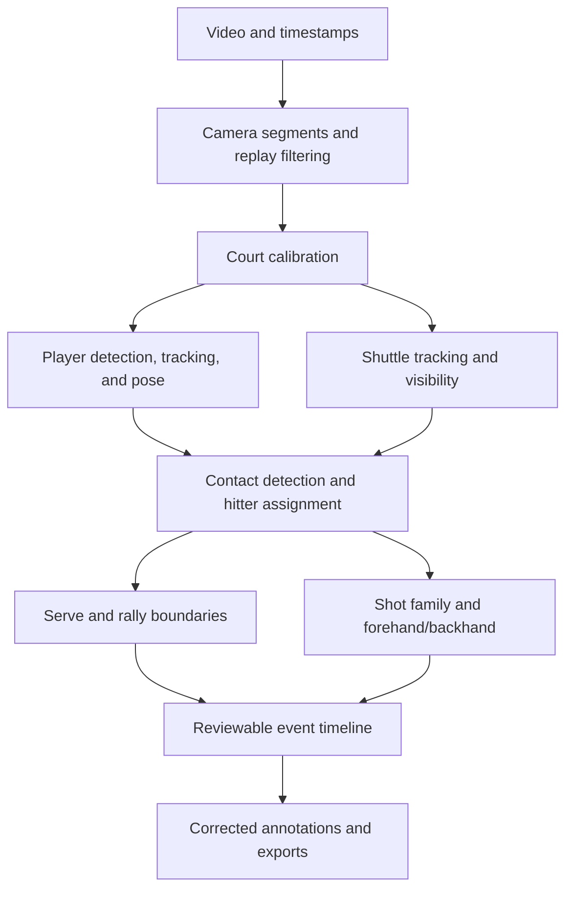

# Badminton match analyzer: project plan

Prepared October 17, 2026.

Scope update: half smash has been removed. The six target families are clear, lift, net, drop, smash, and drive, each with forehand/backhand labeling.

End-state requirement: a polished, deployable application that accepts uploaded videos and YouTube match links and correctly annotates supported singles and doubles footage throughout each match. Keep expanding difficult camera/visibility cases toward that full objective; the existing review tools and small pilot are intermediate deliverables. Claims of complete correctness require verified end-to-end evidence on unseen full matches. Each implementation increment uses a feature branch, focused commits, a tested PR, and a merge into main. Run regression checks and investigate failures continuously.

The input/deployment increment adds bounded video uploads, single-video YouTube imports with source provenance, authentication for a network listener, configurable persistent storage, container targets, and CI checks. Full automatic analysis, playback proxies, camera/replay segmentation, complete-rally labels, and classifier training remain open requirements.

Implementation has begun: video ingestion, the annotation/review application, GPU player/pose tracking, TrackNetV3 shuttle tracking, and reviewable contact proposals are working. See [the initial baseline report](docs/BASELINE_REPORT.md) and [the bug review and latest results](docs/BUG_REVIEW.md) for completed work, measurements, and remaining milestones.

Reviewed tracker-to-player mappings, exhaustive clip review coverage, manual shuttle points, and source-aligned contact/localization evaluation now work through the UI, API, and CLI. A small visually reviewed development pilot covers partial singles and doubles rallies; [its report](docs/PILOT_REPORT.md) distinguishes measured failures from unvalidated accuracy. The gap-aware contact detector removes a false apex and recovers one hit as an uncertain interval, but still misses contacts.

The first recognition increment integrated a pinned pretrained BST-0 singles family head with explicit review, abstention, and preserved source predictions. [Its report](docs/SHOT_RECOGNITION_REPORT.md) describes the adaptation and local GPU/browser checks. It was an experimental inference baseline; subsequent data/side-head work is recorded below. Direct-video recognition evaluation, complete-rally labels, and doubles extension remain required. Keep improving contact recall alongside recognition; several output labels without verified family truth do not establish accuracy.

The data/evaluation increment imports a pinned snapshot of all 44 ShuttleSet matches into a separate source-verified index, with published match splits, known-error quarantine, raw side flags, and no assumed universal frame rate. It adds independent-label family/side/complete-event metrics through the API, CLI, and review screen. [The data report](docs/STROKE_DATA_REPORT.md) records 36,484 source rows and 21,709 label-eligible rows; direct-video alignment remains unverified. Expand independent local full-rally labels and contact recall alongside recognition.

The first learned stroke-side baseline now uses the authors' separate published MMPose feature archive, joined to the quality-filtered labels. It trains a small head on 10,149 clips, selects its epoch on 1,233 validation clips, and evaluates the frozen selected weights on 1,138 test clips. Closed-set side balanced accuracy is 0.942 with known hitter court end; strict balanced recall falls to 0.879 when its abstentions count as misses. The conditional family/court-end/side tuple result is only 0.718. [The side report](docs/STROKE_SIDE_REPORT.md) records those limits, sparse backhand drops/smashes, and the packaged experimental predictor. This does not complete stage 3. The immediate next step is source-video alignment and recognition evaluation on actual YOLO features, followed by missing-contact, rally-boundary, rare-stroke, and doubles work.

The direct-video increment has now run YOLO, TrackNet, contacts, and recognition on a 163-frame public-source excerpt. Both unadjudicated reference windows abstain; [the report](docs/DIRECT_VIDEO_REPORT.md) records the gap between published cached features and actual video inputs. Exact source-contact alignment is still open. An experimental, default-off audio/vision aid adds review intervals containing both missed singles pilot contacts; [its report](docs/AUDIO_CONTACT_REPORT.md) preserves the tighter timing and doubles limitations. Next: independently adjudicate and expand complete live rallies, measure visual/optional-audio contacts, compare recognition at adjudicated YOLO contacts, then train event/domain adaptations on development splits. Serve/rally-end detection, doubles recognition, automatic identity recovery, and full-video segmentation remain unfinished.

The camera-boundary increment scans full videos and separates new player/shuttle processing at detected edits. [The camera report](docs/CAMERA_BOUNDARY_REPORT.md) records both sample scans and a real CUDA probe across two cuts. Tracker ID reuse across views, mixed-camera TrackNet contexts/backgrounds, stale court filtering, and contacts ignoring player-run cuts are addressed. This begins full-video segmentation; live/replay classification, reviewed scene corrections, and an automatic full-match pipeline remain open. Next, establish independent camera/scene and complete-rally labels, add scene corrections/live-replay handling, and continue contact/serve/end and YOLO-domain recognition work.

Reviewed camera corrections and scene ranges are now implemented. Saved corrections drive tracking resets and calibration expiry; changed boundaries invalidate cached inputs. Replay, non-play, and explicitly unknown scene ranges suppress event suggestions without changing raw predictions or reviewed events. A source-verified first visual pass labels 125 intro/title-card frames per sample as non-play, with human adjudication pending. [The scene-review report](docs/SCENE_REVIEW_REPORT.md) records this narrow evidence and the actual CUDA override probe. Automatic scene classification and complete live-rally labels remain open. Next, expand independent full-rally and scene annotations, establish reliable direct-video contact/serve/end evaluation, then improve event and recognition models on development splits before extending to doubles and unseen full matches.

Build an offline video analyzer that produces a reviewable timeline of rallies and shots. Develop a complete singles workflow first, then extend it to doubles while keeping four-player support in the data model from the beginning. Reuse pretrained perception models and train the badminton event and shot classifiers on curated annotations.

The first useful release should combine automatic suggestions with quick correction. Full automation across unfamiliar cameras and venues is a later quality milestone.

## Starting point and assumptions

At planning time, the repository contained two videos and no application code:

| File | Video duration | Resolution | Frame rate | Frames |
| --- | --- | --- | --- | --- |
| `singles.mp4` | 8:00.92 | 1280 × 720 | 25 fps | 12,023 |
| `doubles.mp4` | 8:05.92 | 1280 × 720 | 25 fps | 12,148 |

Both contain audio. Initial visual inspection confirmed that these are edited highlights with replays, close-ups, and alternative camera angles. The first tracking experiments therefore use short inspected full-court windows. Neither file should be assumed to contain an entire match or only complete rallies.

The available GPU is an NVIDIA RTX 3050 Ti Laptop GPU with 4 GB VRAM. Start with small models, one GPU stage at a time, small batches, and cached features. Benchmark before promising a processing speed. Larger training runs may need a separate GPU.

Working assumptions: local video files, offline processing, one target court, and a stable full-court camera during most rallies. Broadcast cuts and replays are expected input conditions to detect. Initial player identification means persistent IDs such as A/B/C/D, with optional user-entered names and handedness.

## Product behavior

1. Import a video and select singles or doubles.
2. Confirm the court corners and player/team assignments; allow handedness to remain unknown.
3. Process the video with progress reporting and resumable stages.
4. Review video synchronized with player boxes, shuttle trajectory, rally boundaries, and shot labels.
5. Jump between events, change labels, adjust timestamps, repair identities, and insert or delete missed or false events.
6. Export annotated video, rally clips, and machine-readable JSON/CSV. Show per-player shot counts and rally lengths derived from the reviewed events.

Every shot record contains its timestamp, rally, hitter, team, shot family, forehand/backhand label, confidence, and review status. Low-confidence results must be visible and editable.

## Label definitions

Store shot family and stroke side separately. This supports all 12 requested combinations without requiring equally large datasets for each combination.

| Field | Values or interpretation |
| --- | --- |
| Event | `serve`, `shot`, `rally_end` |
| Shot family | `clear`, `lift`, `net`, `drop`, `smash`, `drive`, `other`, `unknown` |
| Stroke side | `forehand`, `backhand`, `unknown` |
| Identity | Persistent player ID and team ID; unknown is allowed |
| Evidence | Contact frame/time, optional uncertainty interval, visibility and confidence |
| Review | Predicted, reviewed, or corrected; preserve the original prediction |

A serve is a separate event with a stroke-side label and no required shot-family value. Its contact time starts the rally; link that event from the rally record instead of counting a second opening shot. Service subtypes can be added later.

Draft annotation rules, to be finalized with examples before bulk labeling:

| Family | Main distinguishing evidence |
| --- | --- |
| Clear | Usually overhead contact, sending the shuttle high/deep toward the rear court |
| Lift | Low or underhand contact, sending the shuttle upward toward the rear court |
| Net | Forecourt touch intended to pass close over the net and remain short |
| Drop | Usually overhead contact from farther back, sending the shuttle short with reduced pace |
| Smash | Forceful attacking stroke with a downward outgoing trajectory |
| Drive | Fast, comparatively flat exchange, usually through the midcourt |

These are project annotation conventions, not complete rules for every variation. Include examples of sliced shots, defensive blocks, pushes, net kills, and mishits. Clearly observed strokes outside the six families become `other`; insufficient evidence becomes `unknown`. Do not force a block or net kill into a requested class simply to produce a label.

Forehand/backhand describes the stroke mechanics, not which side of the screen the shuttle occupies. Around-the-head forehands remain forehands. Account for left-handed players and body rotation.


Rally end means the observable termination of play, such as ground contact or a terminal fault, rather than the last racket contact. If the terminal moment is hidden, annotate an uncertainty interval. A missing shuttle detection alone is not proof that the rally ended. Mark rallies cut off at the beginning or end of a video as partial.

## Processing architecture



**1. Video ingestion and camera segments.** Use FFmpeg/PyAV or OpenCV to decode video while retaining source presentation timestamps. Generate a playback proxy with an explicit source-time mapping. Detect cuts, close-ups, non-play, and replay segments so the same rally is not counted twice. Preserve segment labels and allow corrections. Avoid inventing missing contact frames by increasing frame rate: these samples provide one frame every 40 ms.

**2. Court calibration.** Begin with manual corner selection for each stable camera view, then add automatic line/keypoint detection. Use court geometry to select the target court, distinguish sides, and normalize player positions. Allow a margin around the court so lunging players are retained. Recalibrate after camera movement. A court homography maps ground-plane points; it does not recover the position or speed of an airborne shuttle in 3D.

**3. Players and pose.** Evaluate a small pretrained YOLO person/pose model with ByteTrack or BoT-SORT as a baseline. The official implementation supports tracking and pose estimation. Use court context to exclude spectators and officials. [Tracking documentation](https://docs.ultralytics.com/modes/track), [pose documentation](https://docs.ultralytics.com/tasks/pose).

Separate short-lived tracker IDs from persistent player IDs. Near/far court position is an attribute that changes at end changes. In doubles, combine motion, appearance, pose, and team membership to handle crossing teammates and occlusions; identical uniforms will require uncertainty handling and occasional correction.

**4. Shuttle tracking.** Start by evaluating pretrained TrackNetV3 on representative rallies. It predicts shuttle trajectories and includes a trajectory-repair component, with code and checkpoints available. This is a baseline to measure on the supplied videos, not an assumed accuracy guarantee. [Official TrackNetV3 repository](https://github.com/qaz812345/TrackNetV3).

Keep raw detections, visibility, and repaired points separately. Only repair short gaps within the same continuous shot when justified; do not smooth across camera cuts or hide the trajectory change at a hit. A missing or off-screen shuttle is unknown, not a stationary point. Add target-video annotations and fine-tuning if performance is inadequate.

**5. Contact detection and hitter attribution.** Combine shuttle motion changes with wrist/arm motion and player proximity to propose contact times. Start with interpretable rules, then train a small temporal event detector. Audio impacts can be an optional supporting signal after checking synchronization and commentary noise. Associate each contact with the likely hitter using all available evidence; nearest body center alone is insufficient in doubles. Use team alternation as a soft consistency check, preserving possible faults and uncertain events.

**6. Rally detection.** Combine service posture and opening contact, sustained exchanges, terminal-event evidence, and subsequent inactivity. Begin with a state machine and evolve to a learned temporal model if error analysis supports it. Keep uncertainty for occluded endings, service faults, and mid-rally cuts. Scoreboard changes may corroborate events later; they are not required for the first version.

**7. Shot recognition.** Build clips around each detected contact, with pre-contact pose and post-contact shuttle movement. Use time-based windows and masks so different frame rates and rapid exchanges remain aligned. Start with cached pose, player/court coordinates, trajectory, and visibility features feeding a small temporal convolutional network. Predict shot family and stroke side with separate outputs; train only on known labels for each output.

Benchmark that baseline against the Badminton Stroke-type Transformer (BST), whose official repository provides pretrained weights and stroke-classification pipelines. Its label schemes need explicit mapping to this project's categories. [Official BST implementation](https://github.com/Va6lue/BST-Badminton-Stroke-type-Transformer).

Add cropped RGB video or racket keypoints only if they improve the confusing classes enough to justify the annotation and compute cost. Offline inference can use later frames. Classification must accommodate shots intercepted before landing and shots that go into the net or out.

## Data and annotation strategy

The two supplied videos are good development examples, but cannot establish generalization across venues, cameras, players, and rare strokes.

| Resource | Intended use | Adoption checks |
| --- | --- | --- |
| [ShuttleSet](https://arxiv.org/abs/2306.04948) | Singles shot labels and event supervision; the paper reports 44 matches and 36,492 strokes across 18 shot classes | Verify accessible source videos, timing alignment, handedness fields, and class mappings. Its published tactical benchmarks are not equivalent to recognizing shots from raw video. |
| [TrackNetV3 and its linked trajectory dataset](https://github.com/qaz812345/TrackNetV3) | Shuttle-tracking baseline and possible fine-tuning data | Check camera-domain differences, coordinate conventions, and visibility annotations. |
| [S² Doubles Dataset](https://github.com/HuangYuHsien/S2DoublesDataset) | Doubles events, hitter IDs, stroke side, and player positions | A small resource covering six sets. Its source-video instructions specify 30 fps; verify frame-to-time alignment. Its TrackNet trajectories are predictions and should not automatically become ground truth. |
| [BFMD](https://arxiv.org/abs/2603.25533) | Candidate additional full-match supervision for singles and doubles | The paper describes 19 matches with rally and hit annotations. Verify actual artifact availability, source-video access, and usable labels before depending on it. |

For each imported source, record its URL, match identity, original frame rate, timestamps/offsets, label version, and applicable video/data/model terms. Keep source labels alongside the mapped labels. Missing or incompatible labels remain unknown; footage availability alone does not provide training annotations.

Annotation sequence:

1. Inspect both samples and inventory camera views, cuts/replays, blur, shuttle visibility, and complete/partial rallies.
2. Label approximately 20–30 representative rallies per format where available, adding footage if necessary. Aim initially for several hundred shot events and a separately selected set of roughly 500–1,000 shuttle frames across easy and difficult conditions. These are pilot budgets, not sufficient coverage of every rare combination.
3. Independently label at least 15–20% of pilot events twice, including ambiguous strokes and hitter assignments; adjudicate disagreements and revise the guide.
4. Use CVAT or an equivalent video annotation tool for tracks and points, and the project's event editor for shot/rally corrections. Measure annotation time during the pilot before estimating the full labeling budget.
5. Expand with public labels and targeted additional matches. Collect missing classes, left-handed strokes, far-court actions, doubles overlaps, and difficult camera conditions. Hundreds of reliable examples for common labels are a starting objective; use learning curves and class-specific results to decide whether more are needed.
6. Use uncertain development predictions to prioritize new annotations. Keep an independently annotated test set frozen and outside this feedback loop.

Split by complete original match, preferably also by tournament/camera setup. Never randomly split neighboring frames or clips from the same rally. Deduplicate reuploads and cross-dataset matches. The supplied videos become development/regression examples if used to tune the system; acquire separate matches for final evaluation. Track label and model versions so results are reproducible.

## Evaluation and release criteria

Establish baselines before adopting the following provisional engineering targets. Evaluate singles and doubles separately, and report sample counts and uncertainty. These targets are not claims about existing performance.

| Component | Measurement | Initial target or gate |
| --- | --- | --- |
| Shuttle | Precision/recall on manually labeled visible frames, plus false detections on invisible frames; count localization correct within 0.5% of frame diagonal | Visible-frame F1 around 0.90 or better on supported views; also report missing-track duration |
| Contact events | One-to-one event precision/recall/F1 within ±120 ms; additionally report tighter tolerance and timing error | F1 ≥0.90 for singles and ≥0.85 for doubles as initial gates |
| Rally boundaries | Start/end event F1 within ±0.4 s, interval overlap, and false rallies per video hour | Boundary F1 ≥0.90; partial rallies evaluated separately |
| Hitter attribution | Accuracy on correctly matched contacts, broken down by format; identity switches per rally | ≥0.95 singles and ≥0.90 doubles |
| Shot family | Macro F1, per-class precision/recall, confusion matrix | Aim for ≥0.80 macro F1 across the six requested families; disclose sparse or unvalidated classes |
| Stroke side | Balanced accuracy and per-side recall on matched contacts | Aim for ≥0.90, with separate handedness/visibility breakdowns |
| Complete shot event | Correct time, hitter, family, and stroke side together; event precision/recall/F1 | Track from the first prototype; conditional classifier scores alone cannot establish product quality |
| Practical usefulness | Human review time versus labeling the same length of footage from scratch | Aim to reduce review/annotation time by at least half |

Report classifier results both with ground-truth contacts/identities and with predicted inputs to expose error propagation. For abstaining models, report coverage and accuracy together; count unanswered events as misses in the strict complete-event metric. Show all requested family/side combinations explicitly, marking insufficient test support rather than hiding it in an average. Evaluate `other`/`unknown` handling separately.

Before wider release, evaluate on several unseen full videos of each format and varied supported views. Include replays, long occlusions, end changes, left-handed players, missing audio, and truncated rallies. Measure runtime, peak VRAM, and correction burden on this laptop. Select thresholds on validation data and freeze them before the final test.

## Software structure and compute

Use Python with PyTorch, OpenCV, and FFmpeg/PyAV for processing. The implemented environment uses the existing Python 3.10 installation, an isolated virtual environment, and CUDA-enabled PyTorch; its verified dependencies are recorded in `requirements.lock`. Consult the [official installation guidance](https://pytorch.org/get-started/locally/) when adapting the environment to another machine.

The current implementation uses a local FastAPI service, a background worker, and an HTML/CSS/JavaScript video editor served by the API. Revisit a React frontend if editor complexity warrants it. SQLite stores jobs, metadata, events, and corrections; large videos, weights, and frame-level arrays stay in files. Delay distributed services until actual workload requires them.

Proposed modules:

```text
backend/
  ingest/       # decoding, timestamps, segments, playback proxies
  perception/   # court, player tracks, pose, shuttle tracks
  events/       # contacts, hitter assignment, rallies
  recognition/  # shot family and stroke side
  storage/      # schemas, jobs, predictions, corrections
  api/          # upload, status, review, export
frontend/       # video player, overlays, event timeline, corrections
training/       # imports, label mappings, splits, training, evaluation
tests/          # schema, timing, identity and export checks; small fixtures
data/           # manifests and local datasets; large assets outside Git
models/         # manifests and locally fetched weights
```

Core records: `Video`, `CameraSegment`, `Player`, `Team`, `Track`, `Rally`, `ShotEvent`, and `AnnotationRevision`. Store frame index and source timestamp together; preserve source resolution and coordinate transforms. Store model/configuration versions, separate confidence values, and manual corrections. A rerun must not overwrite reviewed labels. Exports should preserve stable event IDs and reviewed/predicted status.

Process chunks with temporal overlap and deduplicate overlap events. Cache expensive tracking and pose outputs so retraining a classifier does not rerun perception. On the 4 GB GPU, load models sequentially and profile memory. Avoid extracting entire collections to uncompressed image folders. Make jobs restartable, with clear failures and cancellation.

## Milestones

Indicative effort for one developer with ML experience and access to a knowledgeable annotator: roughly 10–16 weeks for a useful reviewed singles-and-doubles prototype. Annotation availability, dataset access, and the difficult shot classes can extend this. This estimate excludes a promise of unattended accuracy on arbitrary footage.

| Stage | Approximate effort | Deliverable and exit criterion |
| --- | --- | --- |
| 0. Audit and annotation guide | 3–5 days | Visually audit samples, define labels, inspect candidate datasets, label pilot rallies, and confirm a workable runtime environment. |
| 1. Tracking baseline and review loop | 1–2 weeks | CLI ingestion, manual court calibration, player/shuttle overlays, saved tracks, and basic event correction/export. Quantify tracking failures on both formats. |
| 2. Singles events | 1–2 weeks | Contact times, player assignment, serves, and rally endings on complete singles clips; evaluate against held-out annotations. |
| 3. Singles shot recognition | 2–3 weeks | Train the two-output temporal baseline, compare BST where practical, show all requested labels and uncertainties, and measure per-class errors. |
| 4. Doubles extension | 2–4 weeks | Four persistent players, team-aware hitter attribution, doubles training examples, crossing/occlusion tests, and format-specific metrics. |
| 5. Full-video reliability | 1–2 weeks | Replay/cut handling, resumable jobs, consistent exports, unseen-match evaluation, runtime measurements, and documented supported conditions. |

Stages 1–2 should produce the first useful rally/contact prototype. Do not spend the early schedule optimizing shot classification while shuttle tracks or contact labels remain unreliable. After each stage, prioritize fixes by their effect on complete-event accuracy and review time.

## First implementation tasks

1. Create the project environment, dependency lock, data manifest, and exclusions for large generated assets.
2. Inspect and select five representative rallies from each supplied video, including difficult examples.
3. Write the annotation guide and label those clips manually with contact times, hitter, family, side, and rally boundaries.
4. Run and measure player/pose and TrackNetV3 baselines; export overlays and structured tracks.
5. Build the minimal video/event correction screen and save the first reviewed annotations.
6. Record an error report and choose the next work from evidence: tracking adaptation, event detection, or additional labels.

The first end-to-end acceptance example is a held-out singles rally that opens in the viewer with a correctly timed serve, ordered and attributed shots, a rally end, editable family/side labels, and a consistent JSON export. The same contract then applies to a doubles rally with four persistent players.
