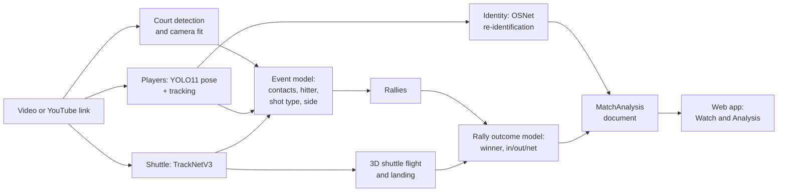

# Badminton match analyzer

Upload a badminton video (or paste a YouTube link), enter the player names,
and get a match page: the video with a live overlay, and statistics for the
whole clip. Works for singles and doubles.

<!-- Demo: replace with the recorded clip, e.g. docs/media/demo.gif -->

> **Status:** research project in active development. Results are automatic
> and measured on professional broadcast matches; amateur footage is
> untested.

## What it does

- **Tracks** the players (one identity per person across the match), the
  shuttle and the court.
- **Finds** rallies, every shot, who hit it, and the shot type: clear, lift,
  net, drop, smash or drive, forehand or backhand.
- **Calls** each rally's landing spot, winner, and whether it ended in a
  winner or an error, and keeps a running score.
- **Estimates** shot speed from a 3D fit of the shuttle's flight.
- **Shows** it all in a web app: **Watch** (video with hitter highlight, last
  shot, a mini court) and **Analysis** (heatmaps, shot breakdowns, landing
  maps, rally lengths, distance covered, winners and errors).

## How it works



Every stage writes into one versioned `MatchAnalysis` document, which the
web app and the statistics read. Values the pipeline did not measure stay
empty instead of being guessed.

## Results

On held-out broadcast test matches, never used for training or for any
design choice:

| | Singles | Doubles |
|---|---|---|
| Rally winner, end to end from raw video | 88.1% | 81.9% |
| Landing spot, median error | 0.28 m | 0.35 m |
| Shot family on known strokes | 84.4% | 78.2% |
| All four players identified correctly | | 94.5% of rallies |

Details and the full evaluation history are in
[docs/REVAMP_PLAN.md](docs/REVAMP_PLAN.md) and [docs/MODEL_CARD.md](docs/MODEL_CARD.md).

## Run it

Requires Python 3.10+, Node.js 22+ (for YouTube imports) and FFmpeg. An
NVIDIA GPU is strongly recommended; CPU works but is slow.

```powershell
py -3.10 -m venv .venv
.\.venv\Scripts\python.exe -m pip install -e '.[dev,tracking,download,youtube,recognition]'
.\.venv\Scripts\python.exe scripts/download_models.py --kind all
.\.venv\Scripts\python.exe -m badminton.cli serve
```

On macOS/Linux use `.venv/bin/python`. For a CUDA build of PyTorch, follow the
[PyTorch install guide](https://pytorch.org/get-started/locally/) first.

Open **http://127.0.0.1:8000**. Containers, authentication and remote access
are covered in [docs/DEPLOYMENT.md](docs/DEPLOYMENT.md).

## Models

`scripts/download_models.py --kind all` installs everything and checks each
file's SHA-256:

- **Public pretrained models** (YOLO11 pose, TrackNetV3, BST) from their
  original publishers.
- **Models trained for this project** from Hugging Face, listed in
  [scripts/project_models.json](scripts/project_models.json) and described in
  the [model card](docs/MODEL_CARD.md).

Weights are never committed to Git. Some models are trained on datasets
licensed for non-commercial use only (for example DShuttleNet, CC BY-NC-SA
4.0) and carry the same restriction.

## Repository layout

| Path | Contents |
|---|---|
| `backend/badminton/` | FastAPI app, processing pipeline, models |
| `backend/frontend/` | React/TypeScript web app (Vite) |
| `training/` | Training and evaluation scripts |
| `scripts/` | Setup, model download and maintenance tools |
| `tests/` | Python and browser tests |
| `docs/` | Design notes and evaluation reports |

## Development

```powershell
.\.venv\Scripts\python.exe -m pytest -q
.\.venv\Scripts\python.exe -m ruff check backend tests scripts
.\.venv\Scripts\python.exe -m ruff format --check backend tests scripts
```

Guidance for contributors (and coding agents) is in [AGENTS.md](AGENTS.md).

## License

The code is under the [MIT License](LICENSE). Model weights, vendored
third-party code and datasets keep their own licenses; see the
[model card](docs/MODEL_CARD.md).
