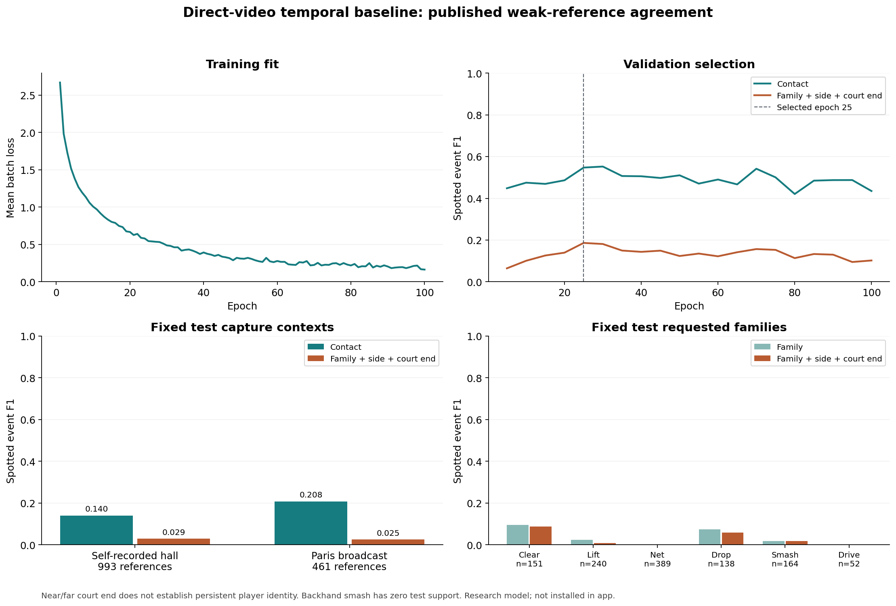

# Direct-video temporal event learning

The experimental learner takes video frames and predicts contacts, shot family,
forehand/backhand, and near/far court end. It requires no supplied contact times,
court calibration, player coordinates or shuttle trajectories. Implementation
and the frozen real-source experiment are complete. Held-out contact F1 is
**0.159**; complete time/family/side/court-end tuple F1 is **0.028**. This baseline
is inadequate for automatic annotation and is not installed in the app.

## Source separation and supervision

The pinned archive and index are documented in the
[AI CUP source report](AICUP_CONTACT_SUPERVISION_REPORT.md). Packaged
`aicup_capture_groups_v1.json` assigns all 969 clips to ten conservative capture
contexts. Source review covered 20 first-scoreboard sheets, five secondary sheets
and four camera-representative sheets. Correspondence leaves 43 exact match names
unresolved. All 175 self-recorded hall clips remain together because three original
recordings have not been fully separated. Capture contexts can contain multiple
matches; they are not independently adjudicated original-match IDs.

Whole Bangkok, Kuala Lumpur, Birmingham, Osaka, Tokyo and both Jakarta contexts
form training. All Odense clips form validation; all Paris and self-recorded hall
clips form test. The 800 labelled-source clips yield 424/176/200 learning
train/validation/test clips with 4684/1707/1454 references. The 169 public unlabelled
`val` clips supply no supervision, normalization or gradients. No ShuttleSet,
S2Doubles or FineBadminton records enter this experiment. Cross-corpus original
source independence remains unresolved. The separate 75-rally ShuttleSet holdout
keeps its original protocol; its media are now recovered and verified, while
model evaluation remains pending.

Each raw contact ordinal H is supervised as the inclusive decoded interval
[max(0,H-1),H] while the universal zero/one base remains unresolved. All 19 H0
references remain censored/unadjudicated and in evaluation denominators. Missing
pre-video observations are never invented. Winner flags, last strokes and clip
edges supply no rally-end targets. Near/far is a court end, not permanent player
identity. Six requested families, `other` and `serve` are retained; half smash is
absent. These are published weak references, not independent semantic truth.

Source support before context filtering follows. Backhand smash has **zero test
support**: this experiment cannot validate that requested class. Counts alone do
not establish adequate coverage or accurate labels.

| Family | Side | Train | Validation | Test |
| --- | --- | ---: | ---: | ---: |
| clear | forehand |410|91|138|
| clear | backhand |39|22|13|
| lift | forehand |384|159|152|
| lift | backhand |458|150|88|
| net | forehand |785|280|207|
| net | backhand |696|311|182|
| drop | forehand |352|100|125|
| drop | backhand |43|20|13|
| smash | forehand |603|210|164|
| smash | backhand |6|6|0|
| drive | forehand |136|39|41|
| drive | backhand |55|30|11|
| other | forehand |157|55|45|
| other | backhand |136|58|75|
| serve | forehand |134|6|19|
| serve | backhand |290|170|181|

## Inputs, learning and evaluation

The frozen encoder uses official generic ImageNet
[MobileNetV3-small weights](https://docs.pytorch.org/vision/0.23/models/generated/torchvision.models.mobilenet_v3_small.html),
enum `IMAGENET1K_V1`, 10,306,551 bytes, SHA
`047dcff4addef86ea5bc2eff13c9614dc11f47ab1160d0a71a25e7db994f4e1f`.
Full oriented RGB frames are letterboxed 512x288, normalized, and pooled 2x2 to
2304 dimensions. This transfer preprocessing differs from the published ImageNet
classification transform; no ImageNet accuracy or author SwingNet reproduction
is claimed. Training augmentation flips actual image pixels before the encoder;
family, biomechanical side and court-end labels remain unchanged.

Source hashes, native PTS, display orientation, complete decode and finite
features are checked. Float16 arrays have hashes and last-written receipts; the
full completion registry and consistent encoder runtime are checked before
learning. The shared incremental scanner preserves the app's
[AdaptiveDetector recipe](https://www.scenedetect.com/docs/0.7/api/detectors.html).
Cuts and source-time gaps isolate contexts; they do not certify live play, court
visibility, replay status or rally boundaries.

Context has 31 bins over plus/minus 0.5 seconds, 25 ms maximum nearest-observation
error, 100 ms maximum source steps, and at least three distinct observations per
flank. Unavailable observations remain zero with explicit masks. The 128-channel
temporal network uses dilations 1/2/4/8 and retains masks at every hidden layer.
A 30 Hz fast path uses actual-frame halos and matches masked-window inference;
VFR inference uses source PTS and explicit windows.

Positive bags keep both plausible ordinals. The highest-scoring valid contact
receives semantic losses. Up to two negatives per supported contact are sampled
without replacement, at least 200 ms from every reference interval. Only original
and mirrored learning-train features determine normalization. The packaged
learning manifest pins seed, optimizer, losses, 100 epochs and validation schedule.

Selection maximizes validation **spotted family+side+court-end tuple F1**, then
contact F1, then earlier epoch. Matching is one-to-one, maximum-cardinality and
minimum interval-distance within 2/30 seconds. This measures weak interval agreement,
not adjudicated exact-contact accuracy. All references, including missing-context
cases, stay in denominators. Metrics disclose all 16 family/side combinations and
counts; unsupported recalls are undefined. Conditional classification is separate.

Test prediction requires completed training and unchanged protocol, normalization,
selected weights, threshold and implementation. Test results never select a model.
The completed experiment followed this schedule without test-based changes.
Generated fixture results establish software behavior only.

## Completed frozen experiment

All **800 labelled clips / 264,791 decoded frames** have verified feature caches.
An independent cache audit checked array hashes, finite values, dimensions,
source clocks, camera cuts and training-only pixel mirrors. The scanner refactor
also exactly matches the prior implementation on every source frame, cut and
reason. This establishes cache integrity and refactor equivalence, not scene
classification accuracy. At the published ordinal intervals, 19/7/3
train/validation/test references have no valid context; all remain in metric
denominators. Timing tolerance can still permit matching a nearby valid center.

The fixed 100 epochs completed, using 4,665 supported positive bags and 13,995
total samples. Validation selected **epoch 25 / threshold 0.5**, with contact F1
0.548 and tuple F1 0.186. The finalized selection was frozen before opening any
test head predictions. Neither the schedule nor the selection rule was changed
after observing results.

All **200 test clips / 1,454 references** were evaluated, producing 653 events.
The primary tolerance is distance at most 2/30 seconds from the published
ambiguous contact interval, using timing-only one-to-one matching before scoring
labels. Missing-context and left-censored references are retained.

| Test requirement | TP | FP | FN | Precision | Recall | F1 |
| --- | ---: | ---: | ---: | ---: | ---: | ---: |
| Contact | 167 | 486 | 1287 | 0.256 | 0.115 | 0.159 |
| Contact + family | 39 | 614 | 1415 | 0.060 | 0.027 | 0.037 |
| Contact + forehand/backhand | 129 | 524 | 1325 | 0.198 | 0.089 | 0.122 |
| Contact + court end | 118 | 535 | 1336 | 0.181 | 0.081 | 0.112 |
| Contact + family + side + court end | 29 | 624 | 1425 | 0.044 | 0.020 | 0.028 |

| Test capture context | Clips | References | Predictions | Contact F1 | Tuple F1 |
| --- | ---: | ---: | ---: | ---: | ---: |
| Self-recorded hall | 149 | 993 | 546 | 0.140 | 0.029 |
| Paris broadcast | 51 | 461 | 107 | 0.208 | 0.025 |

| Family | References | Predictions | Contact + family F1 | Full tuple TP | Full tuple F1 |
| --- | ---: | ---: | ---: | ---: | ---: |
| clear | 151 | 166 | 0.095 | 14 | 0.088 |
| lift | 240 | 8 | 0.024 | 1 | 0.008 |
| net | 389 | 0 | 0.000 | 0 | 0.000 |
| drop | 138 | 105 | 0.074 | 7 | 0.058 |
| smash | 164 | 170 | 0.018 | 3 | 0.018 |
| drive | 52 | 0 | 0.000 | 0 | 0.000 |
| other | 120 | 1 | 0.000 | 0 | 0.000 |
| serve | 200 | 203 | 0.045 | 4 | 0.020 |

The requested six-family macro tuple F1 is **0.029**. No net or drive predictions
survive the selected threshold. Backhand smash has zero test support, so this
experiment cannot establish its accuracy. Over only the 167 timing matches,
conditional family/side/court-end accuracies are 0.234/0.772/0.707. Those
conditional numbers exclude most references and must not be reported as full
annotation accuracy. Court end does not identify a persistent individual.

An independent CPU-only audit exactly recomputed test metrics from saved events
and weak references, with no new inference. Keeping predictions fixed, tolerance
0/1/2 source-grid steps yields contact F1 0.069/0.115/0.159 and tuple F1
0.012/0.019/0.028. The primary tolerance was not changed. This sensitivity is
diagnostic, not a new model selection or independent contact adjudication.



The training loss falls while validation tuple F1 peaks early; held-out capture
contexts perform worse still. This is consistent with poor generalization, but
does not isolate its cause. The frozen generic full-frame encoder, limited
supervision, capture differences and uncertain source labels need development
investigation. The test must not become a tuning set. This baseline is rejected
for app promotion. It is not directly comparable to older classifiers evaluated
conditionally at supplied contact/hitter inputs.

Local immutable evidence is under `.cache/visual-event-learning-v1`: the frozen
protocol, per-source feature receipts, 100-row training history, finalized
selection, selected weights, test events and `results-audit.json`. The committed
[machine receipt](visual-event-learning-verification.json) records their hashes
and summary metrics without redistributing labels, media or weights.

## Commands and job ownership

Install the optional `learning` extra with an appropriate PyTorch build. Use the
same root/data configuration as the app so CLI commands share its admission lock.
For the default repository layout, PowerShell commands are:

```powershell
$env:BADMINTON_ROOT = (Get-Location).Path
$env:BADMINTON_DATA_DIR = Join-Path $env:BADMINTON_ROOT "data/processed"
.venv/Scripts/python.exe -m badminton.cli prepare-visual-features .cache/visual-hit-source-audit-v1/part1.zip --index data/datasets/aicup2023/v1 --weights .cache/visual-event-learning-v1/mobilenet_v3_small-047dcff4.pth --output .cache/visual-event-learning-v1/features
.venv/Scripts/python.exe -m badminton.cli train-visual-events --index data/datasets/aicup2023/v1 --features .cache/visual-event-learning-v1/features --output .cache/visual-event-learning-v1/run
.venv/Scripts/python.exe -m badminton.cli evaluate-visual-events --index data/datasets/aicup2023/v1 --features .cache/visual-event-learning-v1/features --run .cache/visual-event-learning-v1/run --output .cache/visual-event-learning-v1/test.json
```

Feature extraction resumes compatible completed caches. Existing training/test
outputs are preserved. No command installs app weights or edits annotations.

The copied research launcher initially resolved its default data root under
`.cache`, missing the main lock. Fresh PID/creation, command and Store inspection
caught this. The existing worker was adopted into the explicit main Store without
re-inference. Its actual GPU PID owns the main lock; a monitor synchronizes
progress and status. Main annotations were snapshotted from the real Store at
adoption. The empty isolated Store snapshot does not prove preservation of real
annotations. Future frozen launchers must pin root/data before importing config.

## Verification and open work

The final implementation run passed **707 tests with four optional GPU skips**.
Ruff check/format covers 107 files and dependency consistency passes. The built
0.24.0 wheel matches all 70 package files, exposes the three CLI commands, imports
without loading Torch, and refuses an actual competing job in the main Store.
The [machine receipt](visual-event-learning-verification.json) records hashes and
scope. Main annotations match the real adoption snapshot. A runtime check found the old
UI process absent with port8000 closed; the verified64-file0.22.0 release was
restored with explicit root/data settings. Health is OK and its startup preserved
the active research job. The research model was not promoted. Two Torch checks use generated CPU fixtures:
exact fast/window agreement across cuts and chunk edges, and train/freeze/test
behavior including refusal of changed weights/thresholds. They do not measure
badminton accuracy.

Extraction, scanner equivalence on all 800 sources, full training, validation
selection and held-out evaluation are complete. Both supplied annotation files
remain unchanged. Default app inference is unchanged. Doubles learning,
persistent identities, shuttle localization,
independently reviewed full matches, serve/end accuracy, unseen full-video
evaluation and missing-class coverage remain necessary for the user's full goal.

The [follow-up supervision audit](FOLLOWUP_SUPERVISION_REPORT.md) records broader
singles/doubles sources, structural conflicts, source overlaps and rights. It
also records recovery of the original frozen ShuttleSet source: all 75 requested
rallies / 21,610 native frames / 860 rows are prepared and source-clock verified.
CPU preflight finds 26 edits; reviewed close-ups and lingering wipes mean a cut
alone cannot establish clean live-court context. Full 75-rally native perception
and the originally declared conditional model comparison still need completion.
